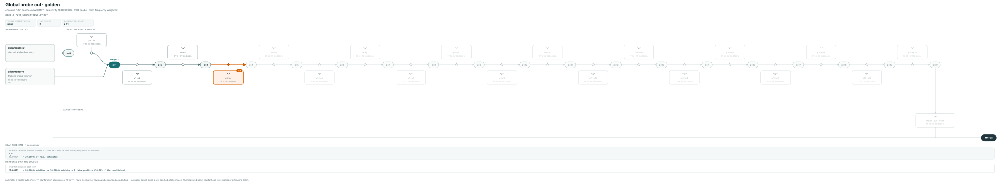

# onpair-graph-viz

Draws the substring prefilter's alignment DAG for a `LIKE '%pattern%'` query and
the cut the planner took on it, from a plan log. OnPair and the FSST port log
the same format, so one renderer serves both.



## Input: a plan log

A directory with three CSVs, written by `examples/plan_log.rs` in the onpair
checkout and `search/tools/plan_log.cpp` in the fsst fork. Both train one
dictionary per row group the way their benchmark candidate does, then log every
needle:

| file | columns |
|---|---|
| `queries.csv` | uuid, dataset, row_group, needle, algorithm, rows, needle_selectivity, cut_selectivity_estimated, cut_selectivity_measured |
| `symbols.csv` | dataset, row_group, algorithm, token_id, content, frequency |
| `graph.csv` | uuid, from, to, label_type, label, cut |

Needles and token contents are base64. The uuid hashes (dataset, row_group,
needle, algorithm). Graph nodes are needle offsets, `0` the start and the
needle length the accept position. `label_type` is `code`, `code-set`,
`code-range`, `escape-code` (FSST; the label is the literal byte) or `none` (a
set too large to enumerate). `cut` is `no`, `yes` or `paired:<code>[;<code>]`,
the last when FSST's cut takes the step only together with the code before it.
The FSST escape code has a `symbols.csv` row with empty content.

```console
$ cargo run --release --example plan_log -- --col C.col --needles N.ndl \
    --dataset clickbench-url-1mi --chunk-rows 524288 --bits 12 --prune 1.0 --out log   # in onpair
$ build-search/search/plan_log --col C.col --needles N.ndl \
    --dataset clickbench-url-1mi --chunk-rows 524288 --out log                         # in fsst
$ cargo run --release -- --log log --algorithm fsst --needle google --out figures
```

Both loggers append, so one directory collects every algorithm and dataset, and
both stop when a cover misses a row that matches.

## Reading the figure

| element | meaning |
|---|---|
| left column, one card per row | a feasible alignment `k`: `k` needle bytes sit at the tail of the first token |
| rounded `p=N` node | parsing has consumed the needle up to byte offset `N` |
| teal filled `p=N`, `merge ×m` | `m` alignments converged here |
| callout card on an edge | the one code a step takes: a greedy token, or `<ESC>` and a literal byte |
| card in the bottom row | an accepting step: tokens the rest of the needle is a prefix of, tokens holding the whole needle, or an escaped last byte |
| **orange** outline, `CUT` badge | taken by the cut |
| `PAIR` badge | taken only as the second code of a pair (FSST) |
| faded node | downstream of the cut |
| `TF`, `RF` | code occurrences in the row group, and TF over its rows |

The **scan predicate** panel lists the cover's terms, runs of ids merged the way
both planners merge them, plus any FSST pairs, and closes with the logged
`cut_selectivity_estimated`. The **measured** line gives
`cut_selectivity_measured` against `needle_selectivity`: rows the cover admits
against rows that match.

Every figure also writes `SLUG-ALGORITHM-UUID8-table.svg`, the row group's whole symbol
table with this cover marked `PROBE` and whole-needle tokens `WHOLE`.

## Notes

* **Size guard.** Each byte-offset state is about 148 units wide. Past
  `--max-states` (default 128) only the table is written.
* **Fonts.** The SVG is self-contained but names a system font stack rather than
  embedding a face.
* **Tests.** `tests/fixtures` holds plan logs of two small corpora, regenerated by
  `tests/fixtures/make.sh` from the onpair and fsst checkouts beside this
  repository. `tests/golden/newsletter.svg` is byte-compared; regenerate with
  `UPDATE_GOLDEN=1 cargo test` and open the diff.
